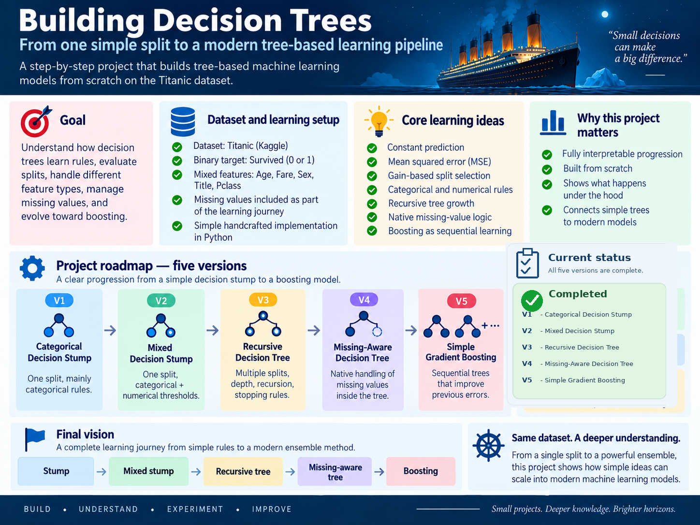

# Building Decision Trees


A progressive educational project that shows how to build **decision-tree learning from scratch**, starting from a one-split categorical stump and evolving step by step toward numerical thresholds, recursive tree growth, native missing-value routing and simple gradient boosting.

The project uses the **Kaggle Titanic dataset** as a constant practical laboratory. Keeping the same dataset across all versions makes each algorithmic change easy to inspect and compare.

The implementation intentionally avoids a ready-made decision-tree estimator. Split generation, error measurement, gain, leaf predictions, recursive growth, missing-value routing and boosting updates are implemented directly so that the mechanics remain visible.

Version 5 completes the original five-stage roadmap with a small gradient boosting model built on top of the missing-aware tree developed in the previous versions.

## Project roadmap

The project follows one main principle:

> **One version, one major concept.**

Version 1 introduces a **Categorical Decision Stump**:

1. learn a constant prediction from the target;
2. measure prediction error with mean squared error;
3. evaluate categorical equality rules;
4. compute weighted split error and gain;
5. select the best one-split rule;
6. learn one prediction for each branch;
7. convert the final values into binary Titanic predictions.

Version 2 adds **Numerical Split Search** while preserving the one-split architecture:

1. distinguish numerical and categorical features;
2. generate numerical thresholds from midpoints between consecutive unique values;
3. keep categorical equality rules;
4. evaluate both split types with the same gain criterion;
5. store the split type and split value explicitly;
6. select the best rule across all features.

Version 3 turns the stump into a **Recursive Decision Tree**:

1. reuse the best-split search at every node;
2. split the full feature and target subsets together;
3. represent internal nodes and terminal leaves explicitly;
4. grow left and right children recursively;
5. stop on pure nodes, maximum depth or no useful gain;
6. route each observation from the root to a leaf during prediction.

Version 4 adds **Native Missing-Value Routing**:

1. keep missing numerical values instead of filling them with medians;
2. separate missing values while evaluating numerical thresholds;
3. test whether missing observations should go left or right;
4. keep the direction that produces the largest gain;
5. store `missing_go_left` inside each numerical node;
6. reuse the learned direction during recursive prediction.

Version 5 adds **Simple Gradient Boosting**:

1. start from the average target value;
2. compute residual errors;
3. train a shallow missing-aware tree on the residuals;
4. scale the tree correction with a learning rate;
5. update the current predictions;
6. recompute residuals and repeat the process;
7. combine multiple shallow trees into one final score;
8. convert the final score into a binary Titanic prediction.

Each version preserves the previous implementation as much as possible so that the effect of the new concept can be studied in isolation.

Version 5 completes the original project roadmap.



## Online notebook

The project can also be explored on Kaggle:

### [Open Building Decision Trees on Kaggle](https://www.kaggle.com/code/lucalullo/building-decision-trees)

## Current capabilities

The final implementation can:

- load the Titanic training and test datasets;
- extract passenger titles from names as a simple engineered feature;
- distinguish numerical and categorical features explicitly;
- learn constant leaf predictions directly from target values;
- compute mean squared error from scratch;
- evaluate weighted split error;
- compute split gain as error reduction;
- evaluate categorical equality splits such as `Title == "mr"`;
- generate numerical threshold candidates from consecutive-value midpoints;
- compare categorical and numerical candidates with the same gain criterion;
- grow a recursive binary decision tree;
- reuse the same feature more than once in different parts of the tree;
- stop tree growth on pure nodes, maximum depth or no useful split;
- preserve numerical missing values without median imputation in the final tree implementation;
- learn whether missing numerical observations should move left or right at each numerical node;
- reuse the learned missing direction during prediction;
- train shallow trees on residual errors;
- update predictions with a configurable learning rate;
- repeat residual fitting through a small gradient boosting loop;
- combine several trees into a final continuous score;
- convert final scores into binary classes with a threshold of `0.5`;
- generate Kaggle submission files for the Titanic competition.

The final Version 5 configuration uses:

```text
Number of boosting trees → 5
Learning rate            → 0.1
Tree maximum depth       → 2
Training objective       → squared-error residuals
Final class threshold    → 0.5
```

## Current architecture

```text
Titanic Data
    ↓
Feature Engineering
Title extracted from Name
    ↓
Feature Types
Age / Fare → numerical
Sex / Title / Pclass → categorical
    ↓
Candidate Split Generation
categorical equality rules
numerical midpoint thresholds
    ↓
Split Evaluation
weighted MSE + gain
    ↓
Missing-Aware Numerical Routing
missing → left or right
choose best gain
    ↓
Recursive Decision Tree
internal nodes + terminal leaves
    ↓
Shallow Tree Learner
(max depth = 2 in Version 5)
    ↓
Initial Constant Prediction
mean(y)
    ↓
Residuals
y - current prediction
    ↓
Train Tree on Residuals
    ↓
Scale Correction
learning_rate × tree prediction
    ↓
Update Current Prediction
    ↓
Repeat for 5 Trees
    ↓
Final Continuous Score
    ↓
Threshold 0.5
    ↓
Binary Titanic Prediction
    ↓
Kaggle Submission
```

The key transition in Version 5 is that a leaf no longer represents only a direct class estimate. Inside boosting, each shallow tree learns a **correction** to the current prediction by fitting the residuals left by the previous trees.

## Project versions

| Version | Main concept | Status |
|---|---|---|
| Version 1 | Categorical Decision Stump | Complete |
| Version 2 | Mixed Decision Stump | Complete |
| Version 3 | Recursive Decision Tree | Complete |
| Version 4 | Missing-Aware Decision Tree | Complete |
| Version 5 | Simple Gradient Boosting | Complete |

## Version 1 - Categorical Decision Stump

Version 1 establishes the complete learning loop with one split.

The model learns a constant prediction, evaluates categorical equality rules with mean squared error, computes the gain produced by each candidate and stores one prediction for the left branch and one for the right branch.

On the selected Titanic features, the learned rule is:

```text
Title == "mr"
```

The learned branch values are approximately:

```text
left  → 0.1567
right → 0.6979
```

Using a classification threshold of `0.5`, Version 1 established the project Kaggle public baseline:

```text
0.75119
```

The version remains intentionally limited to one categorical split so that the complete learning process is visible before introducing numerical thresholds.

## Version 2 - Mixed Decision Stump

Version 2 keeps the one-split architecture and adds correct handling of numerical features.

Numerical candidates use threshold rules such as:

```text
Age <= threshold
```

Candidate thresholds are generated from the midpoints between consecutive unique values. Categorical and numerical candidates are then evaluated with the same gain criterion and compared directly.

The best one-split rule on the current Titanic feature set remains:

```text
Title == "mr"
```

This is an important result: expanding the candidate space does not force the model to choose a numerical feature when the categorical rule still produces the largest gain.

## Version 3 - Recursive Decision Tree

Version 3 introduces recursive tree growth.

Instead of stopping after the best root split, each branch becomes a new training problem. The same best-split logic is reused on the subset of rows that reaches each node.

The learned tree starts from:

```text
Title == "mr"
```

and continues with additional decisions involving `Fare`, `Age`, `Pclass` and `Title` in different branches.

The tree is limited by explicit stopping conditions:

- the node is pure;
- the maximum depth has been reached;
- no candidate produces positive gain.

Prediction follows the learned decisions recursively until a leaf is reached.

## Version 4 - Missing-Aware Decision Tree

Version 4 removes median imputation as a requirement for numerical missing values.

For each numerical threshold, the model evaluates two alternatives:

```text
missing values → left
missing values → right
```

The direction with the larger gain is stored inside the node as:

```text
missing_go_left
```

Training and prediction use the same learned routing rule. This makes missingness part of the tree itself rather than something that must always be removed before training.

The rest of the recursive architecture remains unchanged so that native missing-value routing is the only major new concept introduced by this version.

## Version 5 - Simple Gradient Boosting

Version 5 builds a small gradient boosting model on top of the missing-aware recursive tree.

The model starts from the average Titanic target:

```text
initial prediction ≈ 0.38384
```

It then computes residuals:

```text
residual = target - current prediction
```

A shallow tree is trained on those residuals. Its leaf values therefore represent positive or negative corrections rather than direct probabilities.

The prediction is updated with:

```text
current prediction
+
learning_rate × tree correction
```

The process is repeated automatically for five shallow trees. Each new tree learns from the residual errors left by the previous trees.

The final model therefore represents:

```text
initial prediction
+ 0.1 × tree 1
+ 0.1 × tree 2
+ 0.1 × tree 3
+ 0.1 × tree 4
+ 0.1 × tree 5
```

The resulting continuous score is converted into class `0` or `1` with a threshold of `0.5`.

This is intentionally a simple squared-error boosting implementation. It demonstrates the central boosting mechanism without attempting to reproduce production systems such as XGBoost or LightGBM.

## Documentation

The repository includes general documentation in both English and Italian:

- [General Project Report - English](project-report-en.pdf)
- [Relazione Generale del Progetto - Italiano](project-report-it.pdf)

Each version also contains:

- the complete Jupyter notebook;
- an English version report;
- an Italian version report;
- a version-specific infographic.

Version folders:

- [`v1-categorical-decision-stump/`](v1-categorical-decision-stump/)
- [`v2-mixed-decision-stump/`](v2-mixed-decision-stump/)
- [`v3-recursive-decision-tree/`](v3-recursive-decision-tree/)
- [`v4-missing-aware-decision-tree/`](v4-missing-aware-decision-tree/)
- [`v5-simple-gradient-boosting/`](v5-simple-gradient-boosting/)

## Repository structure

```text
building-decision-trees/
│
├── v1-categorical-decision-stump/
│   ├── building-decision-trees.ipynb
│   ├── Relazione Versione 1 - Stump Decisionale Categoriale.pdf
│   ├── Report Version 1 - Categorical Decision Stump.pdf
│   └── Version 1.png
│
├── v2-mixed-decision-stump/
│   ├── building-decision-trees.ipynb
│   ├── Relazione Versione 2 - Mixed Decision Stump.pdf
│   ├── Report Version 2 - Mixed Decision Stump.pdf
│   └── Version 2.png
│
├── v3-recursive-decision-tree/
│   ├── building-decision-trees.ipynb
│   ├── Relazione Versione 3 - Recursive Decision Tree.pdf
│   ├── Report Version 3 - Recursive Decision Tree.pdf
│   └── Version 3.png
│
├── v4-missing-aware-decision-tree/
│   ├── building-decision-trees.ipynb
│   ├── Relazione Versione 4 - Missing-Aware Decision Tree.pdf
│   ├── Report Version 4 - Missing-Aware Decision Tree.pdf
│   └── Version 4.png
│
├── v5-simple-gradient-boosting/
│   ├── building-decision-trees.ipynb
│   ├── Relazione Versione 5 - Simple Gradient Boosting.pdf
│   ├── Report Version 5 - Simple Gradient Boosting.pdf
│   └── Version 5.png
│
├── infographic.png
├── project-report-en.pdf
├── project-report-it.pdf
├── README.md
├── LICENSE
└── .gitignore
```

## Run locally

### Requirements

- Python 3
- Jupyter Notebook or JupyterLab
- pandas
- Titanic `train.csv` and `test.csv` data

The notebooks were developed for the Kaggle Titanic environment and currently read the competition files from:

```python
PATH = "/kaggle/input/competitions/titanic/"
```

For the simplest reproducible experience, use the Kaggle notebook linked above.

To run locally, clone the repository:

```bash
git clone https://github.com/lucalullo/building-decision-trees.git
cd building-decision-trees
```

Start Jupyter Notebook:

```bash
jupyter notebook
```

Download the Titanic `train.csv` and `test.csv` files, then update the `PATH` variable in the notebook to point to their local directory.

Open the version you want to study and run the cells in order.

For example, to study the final boosting implementation:

```text
v5-simple-gradient-boosting/building-decision-trees.ipynb
```

## Development approach

The project follows one main principle:

> **One version, one major concept.**

Instead of starting with a complete machine-learning library implementation, each version introduces only the next mechanism required to understand how tree-based learning works.

The progression is deliberately cumulative:

```text
categorical split
    ↓
numerical threshold search
    ↓
recursive tree growth
    ↓
native missing-value routing
    ↓
gradient boosting
```

Each completed version remains available as an independent learning resource.

The focus is algorithmic understanding rather than leaderboard optimization. Kaggle provides a consistent external benchmark while the notebook keeps every important learning step explicit and inspectable.

## Roadmap

- [x] Version 1 - Categorical Decision Stump
- [x] Version 2 - Mixed Decision Stump
- [x] Version 3 - Recursive Decision Tree
- [x] Version 4 - Missing-Aware Decision Tree
- [x] Version 5 - Simple Gradient Boosting

The original V1-V5 roadmap is complete.

## Current limitations

Version 5 is intentionally small and educational:

- the implementation is written for clarity rather than computational efficiency;
- numerical threshold search is exhaustive over midpoint candidates;
- categorical splits use one-category-versus-rest equality rules rather than arbitrary category subsets;
- tree growth is controlled only by simple stopping conditions and maximum depth;
- there is no pruning or cost-complexity regularization;
- native learned missing-value routing is implemented for numerical splits;
- the boosting objective uses squared-error residuals for a binary target rather than logistic loss;
- final continuous boosting scores are thresholded at `0.5` and should not be interpreted as calibrated probabilities;
- the final boosting configuration uses only five shallow trees with fixed hyperparameters;
- there is no row subsampling, feature subsampling or stochastic boosting;
- there are no histogram-based split algorithms;
- there is no dedicated train/validation model-selection loop inside the notebooks;
- hyperparameter optimization is outside the project scope;
- the implementation is not intended to reproduce XGBoost, LightGBM or another production gradient boosting library.

These limitations are intentional. The project was designed to expose the mechanics of tree learning and boosting clearly rather than maximize predictive performance or training speed.

## Project status

**Building Decision Trees is complete according to the V1-V5 structure originally planned for the project.**

The repository now contains the full educational path from one categorical rule to a recursive missing-aware decision tree and a small gradient boosting model built from the same tree implementation.

Version 1 established the first working Titanic baseline with a Kaggle public score of `0.75119`.

Versions 2 through 4 progressively generalized the tree architecture by adding numerical thresholds, recursive growth and learned missing-value routing.

Version 5 closes the roadmap by showing how several shallow trees can be trained sequentially on residual errors and combined through a learning rate.

The project can remain finished in this form. Documentation, compatibility fixes or small maintenance updates may still be made when useful.

At the same time, the repository is intentionally not declared permanently frozen. If a future concept is worth studying with the same **one version, one major concept** philosophy, Building Decision Trees may one day receive additional versions beyond Version 5.

There is currently no required Version 6: any future continuation would be a new extension of an already completed project.

## License

This project is distributed under the [MIT License](LICENSE).

## Author

Created by [Luca Lullo](https://github.com/lucalullo).
